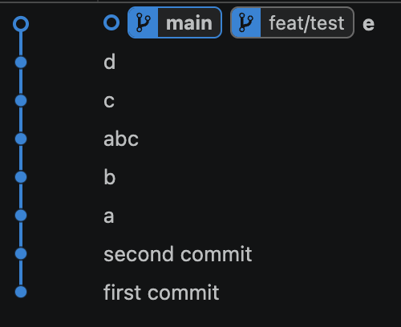

# Cheatsheet for Merge Vs Rebase
1. merge

source branch / target branch နှစ်ခုလုံး အထက်ပါပုံအရ history တူနေသည့်အနေအထားဖြစ်သည် 

ထိုစဥ် main branch တွင် ab ဟူသောcommit တစ်ခုကိုလုပ်ကာ feat/test branch ကို checkout လုပ်၍ main branch မှ pull လုပ်ပြီး main branch တွင် merge လုပ်လိုက်သောအခါ ab သည် c နဲ့  d နောက်မှဖြစ်သယောင်ဖြစ်နေသည်ကိုတွေ့ရမည် 

2. rebase

rebase လုပ်လိုက်သောအခါတွင်မူ  main တွင်တင်ထားသောab သည်  feat/test တွင်တင်ထားသော c d e တို့ရဲ့ အရှေ့သို့ရောက်ရှိသွားသည်